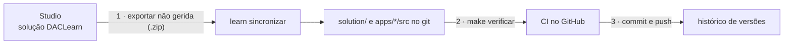

# Ciclo entre o Studio e o git

O Power Apps Studio é onde as apps são feitas, corridas e publicadas. Este repositório guarda cada exportação, desempacotada e legível, para se poder ver o que mudou entre versões e estudar o código.



## 1. Exportar do Studio

No Studio, cada app é guardada e publicada. Depois, em **Soluções**, escolhe-se **Publicar todas as personalizações**.

Em **Soluções › DACLearn › Exportar**, a exportação é **Não gerida**, com o verificador ativo. O portal propõe a versão seguinte, que se aceita.

## 2. Sincronizar

```bash
python -m tools.learn sincronizar ~/Transferências/DACLearn_1_0_0_2.zip
```

O comando substitui `solution/`, reescreve `apps/*/msapp` e `apps/*/src`, guarda o zip em `_export/` e regenera `docs/inventario.md` e `dataverse/schema.md`.

Uma app nova que não esteja em `learn.yaml` fica numa pasta com o nome em minúsculas, e o comando avisa. O passo seguinte é acrescentá-la a `learn.yaml`, com pasta, módulo e passagem, e sincronizar outra vez.

Uma pasta de app que já não esteja na solução também gera um aviso. Apaga-se à mão, se a app saiu de propósito.

## 3. Verificar e guardar

```bash
make verificar
```

```bash
git add -A
git commit -m "Exportação 1.0.0.2"
git push
```

O CI repete a verificação no GitHub. Uma etiqueta por exportação (`git tag v1.0.0.2`) deixa cada versão da solução fácil de encontrar.

## Porque não editar `src/` à mão

Nesta repo, `src/` é o retrato de uma exportação, e não a fonte de verdade. Uma alteração feita aqui só chega ao Studio se for colada lá, e a sincronização seguinte apaga-a.

Para estudar uma fórmula, `python -m tools.learn pt <pasta> <ecrã>` mostra-a como o Studio em português.
